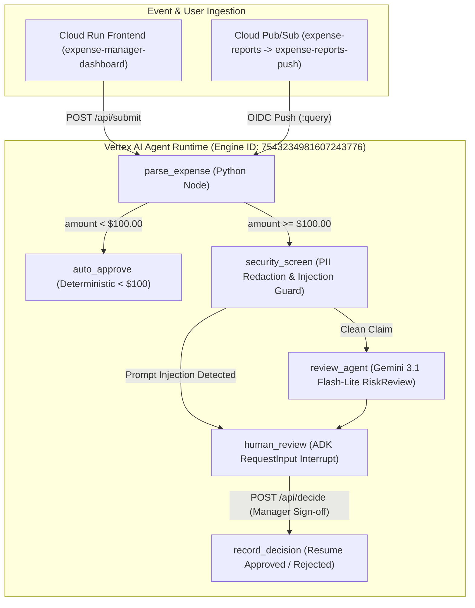

# GEAP & AI Coding (5 Days of AI) — Unified Final Project Repository

**Author**: `raparash@google.com`  
**GCP Sandbox Project**: `raparash-l200-sandbox-297625` (`195807333364`, region `us-central1`)  
**Vertex AI Agent Runtime Resource**: `projects/195807333364/locations/us-central1/reasoningEngines/7543234981607243776`  
**Cloud Run HITL Dashboard**: `https://expense-manager-dashboard-b6v7y6rawa-uc.a.run.app`

---

## Overview

This repository contains the complete, end-to-end production agent package and lab implementations for **5 Days of AI: Gemini Enterprise Agent Platform (GEAP) & AI Coding (L200)**.

At the root of the repository is the production **Ambient Expense Agent** (`expense_agent/` + `submission_frontend/`), unified with **Day 4 AI Security & Coding Guardrails** (`.agents/`, `.semgrep/`, `threat_model.md`, `.pre-commit-config.yaml`), **FDE Spec-Driven Engineering Artifacts** (`SCOPE.md`, `SPEC.md`, `docs/adr/`), **3-Pillar ADK Evaluation Suites & Traces** (`tests/eval/`, `artifacts/`), and **Vertex AI Agent Runtime Deployment Metadata** (`deployment_metadata.json`).

All additional hands-on labs from Days 1, 2, and 4 are also preserved under `labs/` for complete curriculum traceability.

---

## 5-Day Curriculum Mapping

| Curriculum Module | Repository Location | Key Capabilities & Verification Proof |
| :--- | :--- | :--- |
| **Day 1: Build Your First ADK Agent** | `labs/day1-customer-support-agent/` | Scaffolded with `agents-cli`; custom tool definitions (`check_order_status`, `process_return`, `search_faq`); pytest unit & integration suite. |
| **Day 2: Spec-Driven Full-Stack Agent + MCP/Context** | `labs/day2-pantry-planner/` | `DESIGN_SPEC.md`, `agent_development_plan.md`, `integration_plan.md`; `pantry-agent` (`LlmAgent` with SQLite inventory tools) integrated into a FastAPI web UI (`src/`). |
| **Day 3: Ambient Expense Agent (Graph + HITL + Eval)** | `expense_agent/`, `tests/eval/`, `artifacts/` | ADK 2.0 `AgentGraph` (`parse_expense` -> `auto_approve` / `security_screen` -> `review_agent` -> `human_review` -> `record_decision`); `RequestInput` HITL pause/resume; 100% pass across 3 custom eval metrics. |
| **Day 4: Secure Agentic Coding (TDD, Skills, Hooks & SAST)** | `.agents/`, `.semgrep/`, `threat_model.md`, `labs/day4-secure-shopping-assistant/` | `.agents/CONTEXT.md` paved roads; `.agents/hooks.json` `PreToolUse` shell validator; `.agents/skills/stride-threat-model/SKILL.md`; `.semgrep/rules.yaml` API key scanner; `threat_model.md`; TDD tests (`tests/`). |
| **Day 5: Agent Runtime Deployment, Cloud Run UI & Pub/Sub** | `deployment_metadata.json`, `submission_frontend/`, `deployment/terraform/` | Deployed to Vertex AI Agent Runtime (`7543234981607243776`); FastAPI HITL Manager Dashboard deployed to Cloud Run (`expense-manager-dashboard`); Pub/Sub push subscription (`expense-reports-push`) with DLQ (`expense-reports-dead-letter`). |

---

## Architecture: Ambient Expense Agent (`expense_agent` + `submission_frontend`)



---

## Evaluation & Verification Scorecard

All 5 evaluation scenarios in `tests/eval/datasets/basic-dataset.json` were executed and graded against `artifacts/traces/generated_traces.json`:

| Metric / Pillar | Evaluator File | Score | Summary |
| :--- | :--- | :--- | :--- |
| **Routing Correctness** | `tests/eval/routing_correctness.py` | **1.00 (5/5)** | 100% deterministic auto-approval for `< $100`; 100% escalation to `security_screen` and `human_review` for `>= $100`. |
| **Security Containment** | `tests/eval/security_containment.py` | **1.00 (5/5)** | SSNs (`[REDACTED_SSN]`) and credit cards (`[REDACTED_CREDIT_CARD]`) scrubbed pre-LLM; prompt injections bypass `review_agent`. |
| **Response Quality** | `tests/eval/response_quality.py` | **1.00 (5/5)** | Structured `RiskReview` alerts and clear final state transitions (`auto_approved`, `approved`, `rejected`). |

---

## Repository Structure

```text
.
├── .agents/                                  # Day 4: Agent Context, PreToolUse Hooks & STRIDE Skill
│   ├── CONTEXT.md                            # Persistent secure coding & TDD standards
│   ├── hooks.json                            # PreToolUse hook intercepting shell commands
│   ├── scripts/validate_tool_call.py         # Blocks destructive shell execution patterns
│   └── skills/stride-threat-model/SKILL.md   # Custom STRIDE threat modeling skill
├── .semgrep/rules.yaml                       # Day 4: Custom SAST rule detecting hardcoded Google API keys
├── .pre-commit-config.yaml                   # Pre-commit hook running Semgrep SAST scan
├── SCOPE.md                                  # FDE Business Scope & Acceptance Criteria
├── SPEC.md                                   # FDE Technical Specification & Data Contracts
├── threat_model.md                           # Full 6-pillar STRIDE & OWASP LLM Top 10 threat model
├── docs/adr/                                 # Architecture Decision Records
│   └── 0001-hybrid-graph-agent-architecture.md
├── agents-cli-manifest.yaml                  # Agents CLI project manifest (v1.8.0)
├── deployment_metadata.json                  # Live Vertex AI Agent Runtime deployment metadata
├── expense_agent/                            # Day 3 & 5: Core ADK 2.0 Graph Agent
│   ├── agent.py                              # 6-node AgentGraph + PII/Injection guard + RequestInput HITL
│   ├── fast_api_app.py                       # FastAPI + Pub/Sub & Eventarc ingress server
│   ├── config.py                             # Model & threshold configuration
│   └── app_utils/                            # Telemetry, typing, and helper utilities
├── submission_frontend/                      # Day 5B: Cloud Run Expense Manager & HITL Dashboard
│   ├── main.py                               # FastAPI backend + Tailwind UI for Submitting & Approving Claims
│   ├── Dockerfile                            # Production container image for Cloud Run
│   └── pyproject.toml                        # Frontend dependencies
├── deployment/terraform/                     # Day 5A: Terraform IaC for staging/prod deployment
├── artifacts/                                # Day 3: Recorded OpenTelemetry traces & evaluation grade reports
│   ├── traces/generated_traces.json
│   └── grade_results/
├── tests/                                    # Unit, Integration, and ADK Evaluation suites
│   ├── unit/test_expense_workflow.py
│   ├── integration/
│   └── eval/
└── labs/                                     # Complete Day 1, Day 2, and Day 4 Lab Implementations
    ├── day1-customer-support-agent/
    ├── day2-pantry-planner/
    └── day4-secure-shopping-assistant/
```

---

## Quickstart Commands

### 1. Install Dependencies & Run Unit Tests
```bash
uv sync
uv run pytest tests/unit
```

### 2. Run Pre-Commit SAST Scan (Semgrep)
```bash
uvx semgrep scan --config .semgrep/rules.yaml --error
```

### 3. Query Deployed Vertex AI Agent Runtime
```bash
agents-cli run \
  --agent-engine-id 7543234981607243776 \
  --project raparash-l200-sandbox-297625 \
  --region us-central1 \
  --prompt '{"expense_id": "EXP-501", "employee_id": "emp-42", "amount": 48.50, "category": "Meals", "description": "Team lunch"}'
```

### 4. Launch the Expense Manager HITL Dashboard Locally
```bash
cd submission_frontend
GOOGLE_CLOUD_PROJECT=raparash-l200-sandbox-297625 \
GOOGLE_CLOUD_LOCATION=us-central1 \
AGENT_RUNTIME_ID=7543234981607243776 \
uv run uvicorn main:app --host 0.0.0.0 --port 8080
```
