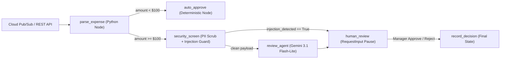

# Technical Specification (`SPEC.md`)

**System**: Ambient Expense Agent (`ambient-expense-agent`)  
**Framework**: Google Agent Development Kit (`google-adk` 2.x) + `agents-cli` (`1.8.0`)  
**Runtime**: Vertex AI Agent Runtime (`projects/195807333364/locations/us-central1/reasoningEngines/7543234981607243776`)  
**Frontend & HITL Ingress**: Cloud Run (`https://expense-manager-dashboard-b6v7y6rawa-uc.a.run.app`) & Cloud Pub/Sub (`expense-reports-push`)

---

## 1. Multi-Node Graph Topology (`expense_agent/agent.py`)

## 2. Data Contracts & Pydantic Schemas

### `ExpenseSubmission`
- `expense_id: str` — Unique claim identifier (e.g., `EXP-1001`).
- `employee_id: str` — Submitting employee identifier.
- `amount: float` — Claim amount in USD (`APPROVAL_THRESHOLD = 100.0`).
- `category: str` — Expense category (`Meals`, `Travel`, `Hardware`, `Software`, `Lodging`).
- `description: str` — Raw business justification (untrusted input subject to `security_screen`).

### `RiskReview` (LLM Structured Output)
- `risk_score: int` (`1` to `5`)
- `policy_concerns: list[str]`
- `recommendation: Literal["APPROVE", "REJECT", "ESCALATE"]`
- `summary: str`

## 3. Infrastructure & IAM Bindings (`raparash-l200-sandbox-297625`)
- **Vertex AI Agent Runtime**: Reasoning Engine `7543234981607243776` (`us-central1`).
- **Cloud Run Service**: `expense-manager-dashboard` (`195807333364-compute@developer.gserviceaccount.com` granted `roles/aiplatform.user`).
- **Event Ingestion**:
  - Topic: `projects/raparash-l200-sandbox-297625/topics/expense-reports`
  - Dead-Letter Topic: `projects/raparash-l200-sandbox-297625/topics/expense-reports-dead-letter`
  - Push Subscription: `expense-reports-push` (`--push-no-wrapper`, `--ack-deadline=600`, `--max-delivery-attempts=5`, OIDC SA `pubsub-invoker@raparash-l200-sandbox-297625.iam.gserviceaccount.com`).
